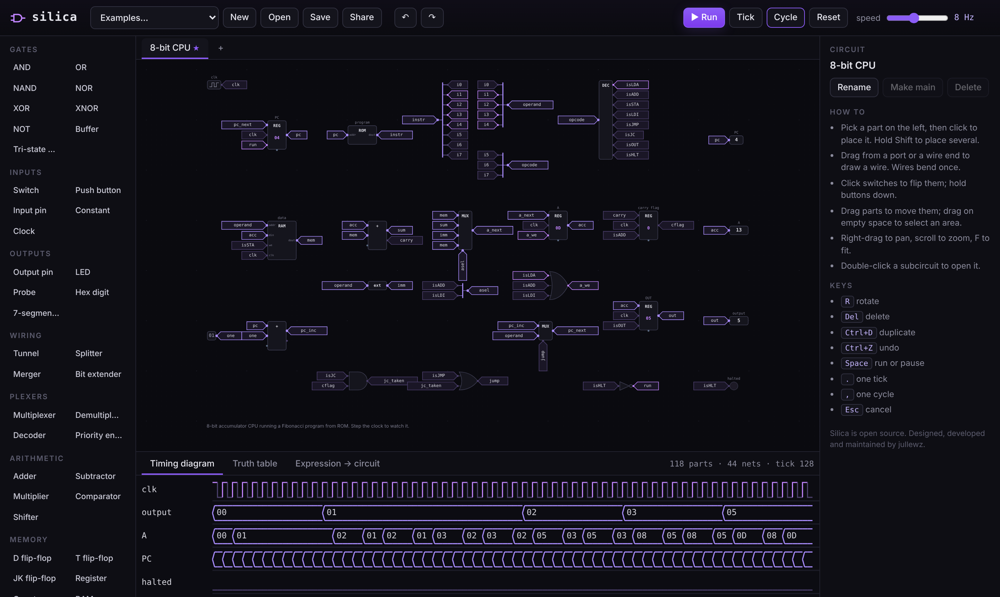
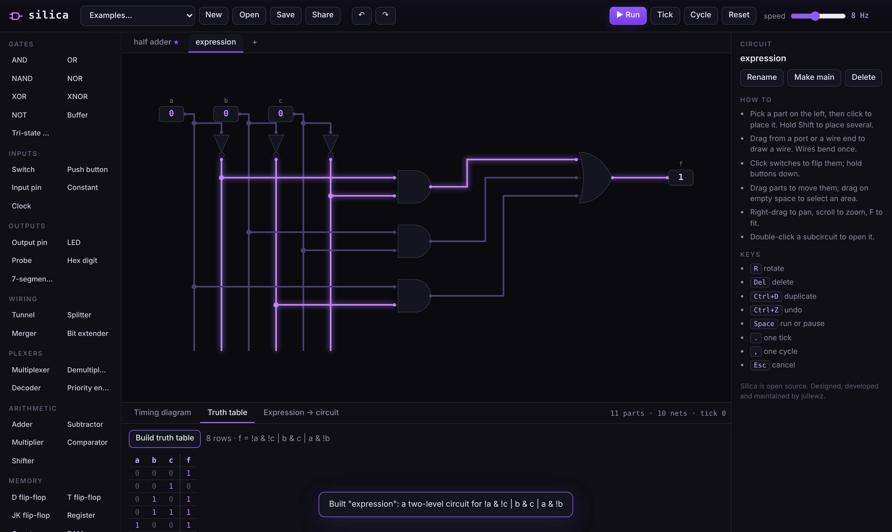
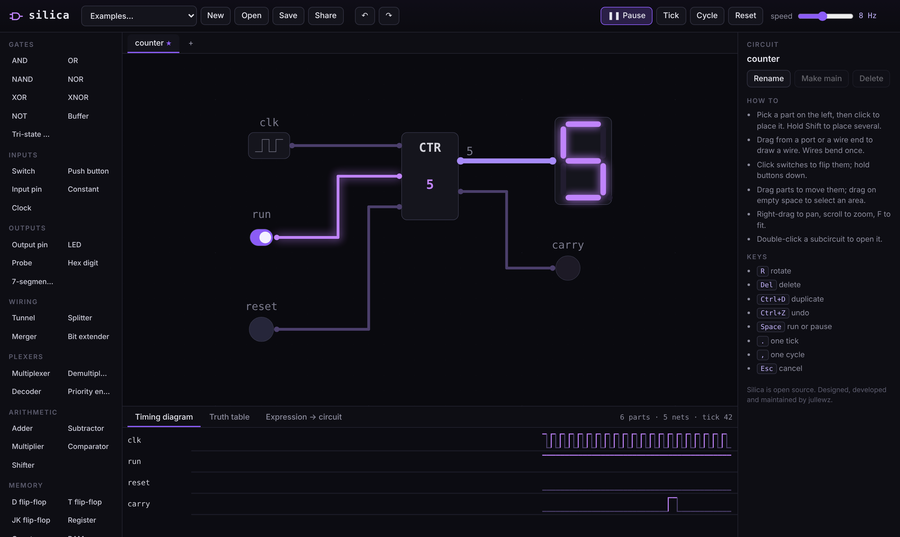

<div align="center">

# SILICA

**Build digital circuits in your browser and watch every signal move.**

Gates, flip-flops, buses, memory and subcircuits, up to a working 8-bit CPU

[](https://github.com/jullewz/silica/actions/workflows/ci.yml)


[](LICENSE)

</div>



Silica is a logic simulator in the tradition of Logisim, built from scratch for the browser. Place gates and parts,
drag wires between them, and the circuit runs as you build it. Wires glow when they carry a 1, buses show their
value, and a timing diagram records every labelled signal.

The examples go from a two-gate half adder to an **8-bit CPU** with a ROM, RAM, an adder, a decoder and a program
counter. It runs a Fibonacci program one instruction per clock cycle, and the test suite checks its output.

## Highlights

- **41 components:** gates with up to 8 inputs on buses up to 32 bits, tri-state buffers, switches, buttons, clocks,
  input and output pins, LEDs, probes, hex and 7-segment displays, tunnels, splitters, mergers, bit extenders,
  multiplexers, decoders, priority encoders, adders, subtractors, multipliers, comparators, shifters, D, T and JK
  flip-flops, registers, counters, RAM and ROM.
- **Four-state logic.** Every bit is 0, 1, X (unknown) or Z (floating). Uninitialised latches show X. Two
  drivers fighting over a bus turn red and get reported.
- **A real event-driven simulator.** Every part takes one unit of delay, so feedback loops, latches and races
  behave like hardware. A circuit that never settles is caught and reported.
- **Subcircuits.** Any circuit in a project can be dropped into another as a single part, nested as deep as you
  like. Double-click one to open it.
- **Analysis tools.** Build a truth table for any circuit and get the simplest Boolean expression for each output.
  Type an expression and Silica draws the circuit for it.
- **Timing diagram.** Waveforms for clocks, pins, probes and LEDs, with bus values written in.
- **Share anything.** A share link carries the whole project, compressed into the URL. Projects also save to files
  and autosave in your browser.
- **Command line.** Run, test and analyse circuit files from a terminal with `silica`.

| Synthesis and truth tables | A live counter |
| --- | --- |
|  |  |

## Run it

Silica needs [Node.js](https://nodejs.org/) 20 or newer to build. It runs in any modern browser on Windows 10 and
11, macOS and Linux.

```bash
git clone https://github.com/jullewz/silica.git
cd silica
npm install
npm start            # builds, then serves http://127.0.0.1:5173
```

`npm run site` builds a static copy into `site/`, ready for any web host. The included GitHub Pages workflow
publishes it on every push to `main` once Pages is enabled (Settings → Pages → Source: GitHub Actions).

## Using the editor

| To | Do this |
| --- | --- |
| place a part | click it in the palette, then click on the canvas (hold Shift to place several, R to rotate) |
| draw a wire | drag from a port or a wire end; the wire bends once |
| branch a wire | drag from the middle of an existing wire |
| flip a switch, set a pin | click it; hold push buttons down |
| select | click, Shift-click, or drag a box on empty space |
| move, rotate, delete | drag, R, Delete |
| duplicate, undo, redo | Ctrl+D, Ctrl+Z, Ctrl+Shift+Z |
| pan and zoom | right-drag, scroll wheel, F to fit |
| run the clock | Space, or the Run button; `.` for one tick, `,` for one cycle |
| change a part | select it and edit its properties on the right: width, inputs, label, ROM contents… |
| reuse a circuit | add a tab with +, build it with input and output pins, then pick it under *Circuits* |

## The 8-bit CPU

```text
 0  LDI 0     4  LDA 30    8  STA 29    12  STA 31
 1  STA 30    5  OUT       9  LDA 31    13  JMP 4
 2  LDI 1     6  ADD 31   10  STA 30    14  HLT
 3  STA 31    7  JC 14    11  LDA 29
```

Eight instructions, a 5-bit program counter, 32 bytes of RAM and an accumulator. It prints 0, 1, 1, 2, 3, 5, 8, 13,
21, 34, 55, 89 and 144, then halts when the next sum overflows 8 bits. Every part of it is a normal Silica
component you can click on, probe and change. Select the ROM to load your own program. The instruction set and
the datapath are described in [docs/simulation.md](docs/simulation.md#the-8-bit-cpu-example).

## Command line

```bash
npm link                                            # once, to get the silica command
silica examples                                     # half-adder, full-adder, ripple-adder, sr-latch, counter, cpu
silica run cpu --cycles 60 --watch PC,A,output      # print signals cycle by cycle
silica run my-circuit.silica.json --set A=7 --set B=12
silica table half-adder                             # truth table and simplified expressions
silica simplify "a & b | a & !b"                    # → a
silica synth "a & b | b & c | a & c" -o maj.json    # build a majority circuit
silica check my-circuit.silica.json                 # width mismatches, oscillation, bus conflicts
```

```text
$ silica table half-adder
 A  B  │  S  C
 0  0  │  0  0
 0  1  │  1  0
 1  0  │  1  0
 1  1  │  0  1
S = !A & B | A & !B
C = A & B
```

## How it works

```text
 editor (src/ui)            core (src/core, no DOM: runs in Node and the browser)
 ───────────────            ──────────────────────────────────────────────────────────────
 canvas, palette,   edit →  circuit.ts     grid model → union-find over wire points and ports
 properties, panels         │              → nets, width checks, flattened subcircuits
        ▲                   ▼
        │                   simulator.ts   event queue, unit delay per part, bus resolution,
   live values  ◀───────── │              clock ticks, oscillation guard
                            components.ts  41 parts: ports, parameters, evaluate()
                            signal.ts      4-state values packed in 32-bit masks
                            analysis.ts    truth tables, Quine–McCluskey, synthesis
```

Read [docs/simulation.md](docs/simulation.md) for signals, nets, timing and the CPU. Every part is described in
[docs/components.md](docs/components.md).

## Tests

```bash
npm test
```

The suite (30 tests in `node:test`) covers four-state logic and bus resolution, every component, the netlist rules
(junctions, crossings, tunnels, width errors, rotation), oscillation detection, saving and share links, every
example (the 4-bit adder on all 256 inputs, the latch, the counter, the CPU's exact output), minimisation,
synthesis checked against truth tables, and the command line. CI runs the suite on Linux, macOS and Windows with
Node 20 and 22.

## Project layout

```text
src/core/    signal.ts  components.ts  circuit.ts  simulator.ts  analysis.ts  serialize.ts  examples.ts
src/ui/      app.ts  render.ts
src/cli/     silica.ts
tests/       core.test.ts  examples.test.ts  cli.test.ts
scripts/     serve.mjs  build-site.mjs  screenshots.mjs  components-doc.mjs
docs/        simulation.md  components.md  assets/
```

## Limitations

- Every part has the same delay of one time unit. Silica models logic, not analog timing, rise times or power.
- Truth tables handle up to 16 input bits. Synthesis handles up to 8 product terms.
- RAM is up to 16 address bits. A project runs on one thread, so very large circuits slow the editor down.

## Creator

Silica was created by [jullewz](https://github.com/jullewz).

Designed, developed and maintained by jullewz.

## License

[MIT](LICENSE) © 2026 jullewz
